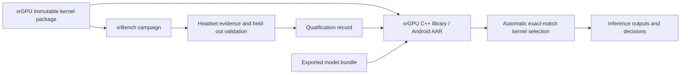

# From xrBench evidence to automatic model inference

xrGPU owns the kernels, compiled packages, integration hooks, exporter, and
inference library. xrBench runs that same package on a headset and evaluates the
original measurements. The resulting qualification record is embedded when the
library is built. Applications load an exported model through `Session`; they do
not select kernels themselves.



## Build a package and export models

Use the repository environment and pinned ExecuTorch checkout. These commands
run from the xrGPU repository:

```sh
python -m runtime.kernel_package build --output artifacts/packages/quest3-fp32-release \
  --executorch artifacts/deps/executorch \
  --glslc artifacts/toolchain/shaderc/2026.4/bin/glslc
python -m runtime.kernel_package verify artifacts/packages/quest3-fp32-release
python -m models.export --offline --package artifacts/packages/quest3-fp32-release
python -m runtime.model_bundle artifacts/model-bundles/minilm-32 --execute-cpu
```

`--offline` requires the pinned pretrained weights in the local cache. Omit it
for an explicit public weight download. See [model export](../models/README.md)
for the exact models, weight digests and preprocessing. Bundles contain static
FP32/INT64 tensor specifications, hashed CPU and Vulkan programs, and seeded
reference fixtures. Unsupported Vulkan lowering is recorded while preserving
the CPU program.

The immutable optimized package is separate from `xrgpu.benchmark-kernels.v1`,
the existing xrBench matmul/calibration source package. Qualification never
changes either package. A native build embeds the exact verified SPIR-V bytes;
it does not recompile the qualified replacements with another compiler.

## Collect and qualify in xrBench

Run `python -m engine.qualification_fixtures --help` in xrBench to export the
regression and operator fixtures against this package. It retains all 80 current
regression cases, adds semantic/packing/tail boundaries, and exports disjoint
discovery and confirmation seeds. Include the exported MiniLM and MobileNetV2
bundles in the campaign workloads. The workflow commands are:

```sh
python -m engine.qualification_build --package /absolute/package \
  --xrgpu-source /absolute/xrGPU --output engine/.build/qualification --xr
python -m engine.qualification_campaign prepare --package /absolute/package \
  --package-sha256 PACKAGE_SHA256 --workloads workloads.json \
  --target target.json --output campaign.json
python -m engine.qualification_campaign run --help
python -m engine.qualification_campaign shortlist --campaign campaign.json \
  --output shortlist.json screening-reports/*.json
python -m engine.qualification_campaign candidates --campaign campaign.json \
  --shortlist shortlist.json --output candidate-rules.json operator-reports/*.json
python -m engine.qualification_campaign assess --campaign campaign.json \
  --shortlist shortlist.json --output assessment.json confirmation-reports/*.json
python -m engine.qualification_campaign export --campaign campaign.json \
  --shortlist shortlist.json --output qualification.json confirmation-reports/*.json
```

`run` collects one explicit stage/workload/seed/session, preserves transport state,
and can recover original reports after a disconnect. Use `--xr` for sustained
evidence. The qualification-only Android activity runs the same inference core
alongside the existing 72 Hz OpenXR scene. It records real frame metrics, focus,
refresh, thermal state and charging state. Shell runs cannot manufacture XR
evidence. The legacy matmul CLI remains `python -m engine.qualification`.

After operator confirmation and controls, `candidates` freezes the exact rules
to use for the full regression suite, model comparisons and sustained runs.
Pass those rules to `run --rules candidate-rules.json`. Candidate rules are
development inputs; only `export` can produce a production qualification record
after all applicable gates pass. Include the required regression, control,
confirmation, model and XR reports when assessing or exporting a campaign.

Screen all 18 linear variants, freeze at most three per request, and confirm on
held-out fixtures in three fresh sessions. Latency runs require at least ten
balanced randomized pairs, 20 warmups and 100 measurements per arm. Tracing is
collected separately. Stock/stock, incorrect-output and slower controls validate
the measurement path. Necessary correctness repairs are applied in both timing
arms.

Performance eligibility requires at least 5% invocation improvement with a
pair-bootstrap 95% confidence interval above zero and p95 regression no greater
than 5%. Both complete models must pass their reference checks and remain within
5% median/p95 regression; at least one must improve median latency by 10% in
confirmation sessions. Sustained validation uses ten minutes per arm at 72 Hz,
frame-p95 regression no greater than 5%, and missed-frame increase no greater
than one percentage point. Correctness repairs have their own eligibility and
do not need to demonstrate a speedup.

Reports are self-reported measurements, not hardware attestation. Preserve raw
reports and the immutable campaign/shortlist. Synthetic protocol tests, host CPU
execution, missing stages, stale package hashes and mixed devices cannot produce
a production qualification record.

## Build and use the qualified library

Copy the qualification record to an explicit local release input, then build in
xrGPU:

```sh
python -m runtime.kernel_package verify /absolute/package \
  --qualification /absolute/qualification.json
python -m runtime.build --library --package /absolute/package \
  --qualification /absolute/qualification.json
```

The Android output is `library/build/outputs/aar/library-release.aar`. The CMake
installation exports `xrgpu::runtime` through `find_package(xrGPU CONFIG REQUIRED)`.
Use `python -m runtime.build --host --package /absolute/package` to build the CPU
host library and runner. Omit `--qualification` to build an unqualified library;
that grants no replacement eligibility. `--experiments` creates an explicit
development library for xrBench and must not be used for a production release.

Java, after placing a bundle in an app-readable directory:

```java
try (org.xrgpu.Session model = org.xrgpu.Session.load(bundleDirectory)) {
    org.xrgpu.Tensor[] outputs = model.forward(inputIds, attentionMask, tokenTypes);
    String decisions = model.info();
}
```

C++:

```cpp
#include <xrgpu/session.h>
auto model = xrgpu::Session::load(bundle_directory);
auto outputs = model->forward(inputs);
auto decisions = model->info();
```

Sessions check bundle hashes, runtime compatibility and tensor contracts before
execution. Qualified replacements require exact device/GPU/driver and operation
descriptors. Supported stock operations remain available. A missing necessary
correctness repair, unsupported device or unavailable Vulkan selects the
whole-model CPU program with a visible fallback reason. Corrupt bundles fail
validation. Outputs own their storage and survive subsequent calls or closing
the session.

## Validation without a headset

Run Python suites in both repositories, the Java tokenizer/tensor checks, native
CPU inference and external CMake consumers, model reference checks, shader-byte
integrity, Android AAR/APK compilation, lint and external Gradle consumers. The
qualification tests exercise failed controls, mismatched provenance, holdout
leakage and pending evidence. These checks establish software behavior; headset
GPU correctness, latency wins and sustained XR gates remain pending until real
device measurements pass.
